# Architecture

## Table of Contents

- [Context](#context)
- [Packages](#packages)
- [One Tool Call](#one-tool-call)
- [The Claims Case](#the-claims-case)
- [State and Storage](#state-and-storage)

---

## Context

An operations team receives claim email. claims-intake reads each message, builds a claim case, checks it against the federal minimums, and asks the claimant for anything missing. A person approves every outbound email. The TMS answers shipment lookups. A model provider (Anthropic or OpenAI) supplies the language understanding; it never holds state and never acts on its own.

```mermaid
---
config:
  theme: dark
  flowchart:
    nodeSpacing: 70
    rankSpacing: 50
    diagramPadding: 20
    subGraphTitleMargin:
      top: 15
      bottom: 10
    curve: basis
---
flowchart TB
  subgraph main [" claims-intake in context "]
    direction TB
    Inbox["Claims inbox (email)"]
    App["claims-intake"]
    Person["Claims specialist (approves sends)"]
    TMS["TMS (shipment lookup)"]
    Model["Model provider (Anthropic or OpenAI)"]
    Out["Claimant (receives approved email)"]
    Inbox --> App
    App <--> TMS
    App <--> Model
    App --> Person
    Person --> App
    App --> Out
  end

  classDef blue fill:#cce5ff,stroke:#0056b3,color:#004085
  classDef gray fill:#e9ecef,stroke:#6c757d,color:#495057
  classDef green fill:#d4edda,stroke:#28a745,color:#155724

  class App blue
  class Inbox,TMS,Model,Out gray
  class Person green

  style main fill:#1e1e2e,stroke:#cdd6f4,stroke-width:2px
```

Blue is this system, gray is outside it, green is the person in the loop.

## Packages

Dependencies point one way: `llm` first; `agentcore` and `telemetry` build on it; `statecore`, `knowledge`, `integrations` and `evals` stand beside them; applications sit on top. An application owns its prompts, tools, state machine and policies; the packages own everything that is the same for every application.

## One Tool Call

Every call the model makes takes the same path. Input validation runs first; pre-hooks decide whether the call runs (the first refusal wins); the tool runs; output validation and post-hooks follow; the audit log records every outcome, refusals included.

```mermaid
---
config:
  theme: dark
  flowchart:
    nodeSpacing: 70
    rankSpacing: 50
    diagramPadding: 20
    subGraphTitleMargin:
      top: 15
      bottom: 10
    curve: basis
---
flowchart TB
  subgraph main [" One tool call "]
    direction TB
    Call["Model asks for a tool call"]
    Validate["Validate input"]
    Budget["Budget"]
    State["State allowlist"]
    Taint["Taint and recipient checks"]
    Idem["Idempotency (replay a repeated write)"]
    Approve["Approval (sends wait for a person)"]
    Run["Run the tool"]
    Post["Validate output, redact, cap size"]
    Audit["Audit every outcome"]
    Call --> Validate --> Budget --> State --> Taint --> Idem --> Approve --> Run --> Post --> Audit
  end

  classDef blue fill:#cce5ff,stroke:#0056b3,color:#004085
  classDef red fill:#f8d7da,stroke:#dc3545,color:#721c24
  classDef gray fill:#e9ecef,stroke:#6c757d,color:#495057

  class Call,Run gray
  class Validate,Budget,State,Taint,Idem,Approve red
  class Post,Audit blue

  style main fill:#1e1e2e,stroke:#cdd6f4,stroke-width:2px
```

Red steps can refuse the call; blue steps shape and record the result.

## The Claims Case

```mermaid
---
config:
  theme: dark
  flowchart:
    nodeSpacing: 70
    rankSpacing: 50
    diagramPadding: 20
    subGraphTitleMargin:
      top: 15
      bottom: 10
    curve: basis
---
flowchart TB
  subgraph main [" Claim case states "]
    direction TB
    received --> triaged
    received --> not_a_claim --> closed
    triaged --> extracted
    extracted -- "nothing missing" --> ready_to_file --> handed_off
    extracted -- "something missing" --> needs_info
    needs_info -- "person approves the email" --> awaiting_reply
    awaiting_reply -- "reply" --> triaged
    awaiting_reply -- "7 days, no reply" --> needs_info
  end

  classDef green fill:#d4edda,stroke:#28a745,color:#155724
  classDef gray fill:#e9ecef,stroke:#6c757d,color:#495057

  class ready_to_file,handed_off green
  class not_a_claim,closed gray

  style main fill:#1e1e2e,stroke:#cdd6f4,stroke-width:2px
```

Green states end with a claim ready for filing; gray states end without one. The guards on `extracted` are code, not prompts: `complete` is refused while any 49 CFR 370.3(b) minimum or the delivery date is missing.

## State and Storage

Each store is one SQLite file under the state directory: the event log (append-only, enforced by triggers), the approval queue, idempotency keys and the audit log. Outbound mail is written as `.eml` files by the file transport in the demo; a real deployment swaps in an SMTP or API transport behind the same interface.
